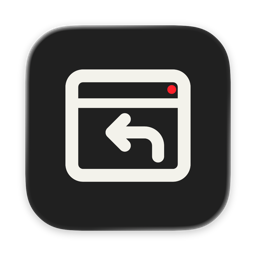
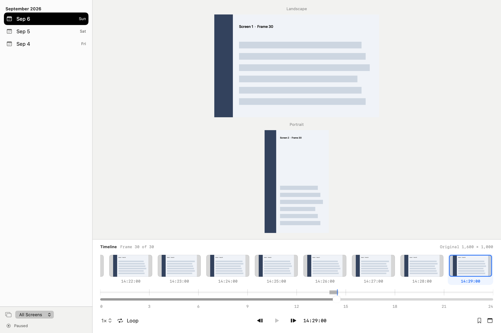

# ScreenRecall

[English](README.md) · [简体中文](README.zh-Hans.md) · [日本語](README.ja.md) · [한국어](README.ko.md) · [Español](README.es.md)

## Historial de pantalla local para macOS

Guarda momentos de la pantalla en tu Mac. Explora por fecha, hora y monitor, y añade favoritos o notas a las imágenes que importan.


## Funciones

Explora una cronología visual de varios monitores. Encuentra momentos mediante favoritos, notas y búsqueda de metadatos. Captura a intervalos, toma una imagen o usa una ráfaga breve.



[Apariencia oscura](Documentation/product-dark.png)

## Privacidad y almacenamiento

Las imágenes, el catálogo SQLite y las preferencias permanecen en el Mac. No requiere cuenta ni servicio en la nube. La captura necesita permiso de grabación de macOS y puede incluir cualquier contenido visible. Al iniciar, puede reanudarse el estado de grabación guardado.

## Límites

La búsqueda usa metadatos del catálogo; no reconoce texto dentro de imágenes (OCR). Aún no hay una distribución binaria pública notarizada. La interfaz tiene ocho idiomas; esta documentación sigue los cinco del sitio web.

## Compilar y probar

Requiere macOS 27+, Xcode con Swift 6.2+ y herramientas de Icon Composer, pkg-config y libwebp 1.6.0. Incluye la fuente fijada DeparturePixelZh Compact y sus avisos. Instala las herramientas por separado.

En orden: compilar sin firmar, instalar ni abrir; preparar una app firmada; abrir una demo sintética y conservar la app diaria.

```sh
./script/build_and_run.sh --unsigned-only
./script/build_and_run.sh --build-only
./script/build_and_run.sh --demo
```

## Ubicación de datos

Las preferencias y la biblioteca usan Library/Application Support/ScreenRecall en la carpeta personal. Las compilaciones, demos y copias de la app anterior usan Library/Caches/ScreenRecall, fuera del código. Una instalación existente puede conservar su ubicación de datos.

Opciones: caché de compilación `SCREENRECALL_BUILD_ROOT`; capturas y datos de ejecución de la app instalada `SCREENRECALL_DATA_DIRECTORY` (conserva el valor existente si no se define); identidad `SCREENRECALL_SIGN_IDENTITY` (usa la guardada, una identidad Apple disponible o firma ad hoc); fuente fijada `DEPARTURE_PIXEL_ZH_BUILD_ROOT` (rechaza bytes modificados).

Las preferencias normales permanecen en `Library/Application Support/ScreenRecall` del usuario actual de macOS; cambiar `HOME` en la terminal no las aísla. Usa `--demo` para probar con datos sintéticos aislados.

`./script/build_and_run.sh --verify` instala y abre la app. Puede reanudar el estado de grabación guardado.

## Licencia

Código propio: [GPL-3.0-only](LICENSE), [alcance](LICENSE_SCOPE.md). Capas originales del icono: CC BY 4.0, [ilustraciones](ARTWORK.md). Las dependencias y fuentes conservan sus condiciones: [avisos de terceros](THIRD_PARTY_NOTICES.md).

ScreenRecall · codingEzio · 0.5.9 (24).
