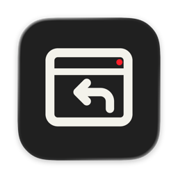
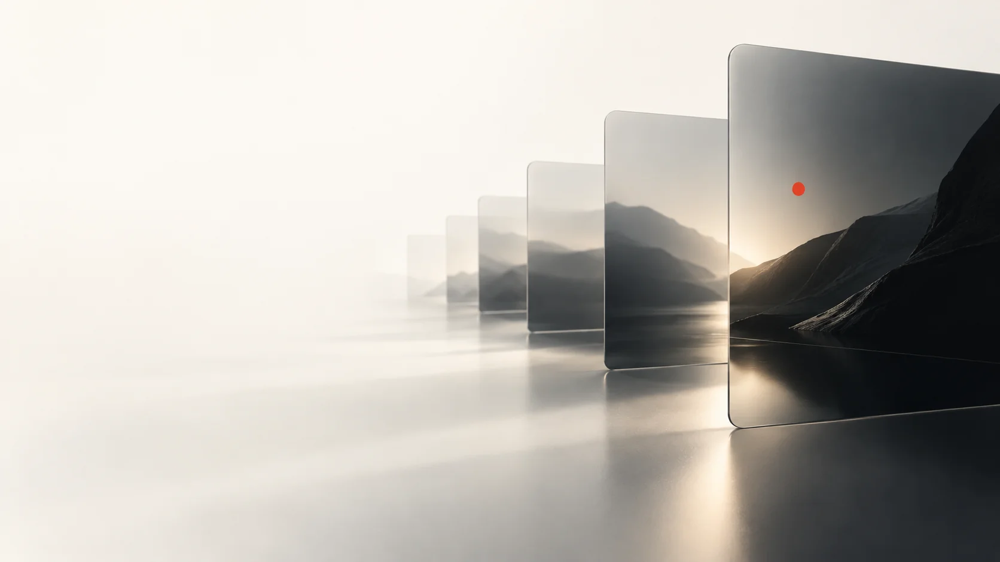
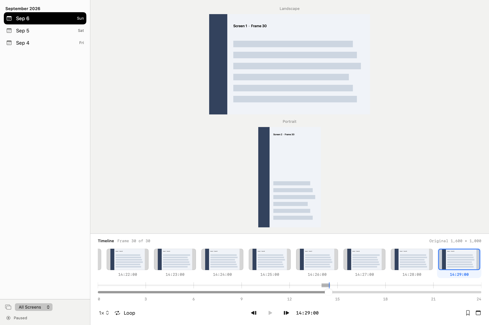

# ScreenRecall

[English](README.md) · [简体中文](README.zh-Hans.md) · [日本語](README.ja.md) · [한국어](README.ko.md) · [Español](README.es.md)

## macOS のローカル画面履歴

画面のひとこまを Mac に保存。日付、時刻、ディスプレイから振り返り、大切な画像にはお気に入りやメモを付けられます。



## できること

複数ディスプレイの画面を時系列で閲覧し、お気に入り、メモ、メタデータ検索で探せます。指定間隔の記録、単発キャプチャ、短時間の連続記録に対応します。



[ダーク表示](Documentation/product-dark.png)

## プライバシーと保存

画像、SQLite カタログ、設定は Mac 内に保存します。アカウントやクラウドは不要です。記録には macOS の画面収録権限が必要です。表示中の内容は記録される可能性があります。起動時に保存済みの記録状態を再開する場合があります。

## 制限

検索対象はカタログのメタデータです。画像内の文字認識（OCR）はありません。公証済みの公開バイナリはありません。UI は8言語、この説明はウェブサイトと同じ5言語です。

## ビルドと試用

macOS 27 以降、Swift 6.2 以降と Icon Composer ツールを含む Xcode、pkg-config、libwebp 1.6.0 が必要です。固定版 DeparturePixelZh Compact とライセンス文書を同梱しています。開発ツールは別途用意してください。

順に、署名・インストール・起動を行わないビルド、署名済みアプリの準備、日常用アプリを保持した合成データのデモ起動です。

```sh
./script/build_and_run.sh --unsigned-only
./script/build_and_run.sh --build-only
./script/build_and_run.sh --demo
```

## 保存先

通常の設定と画像ライブラリはホーム内の Library/Application Support/ScreenRecall を使用します。ビルド、デモ、旧アプリの保管先はソース外の Library/Caches/ScreenRecall です。既存の保存先も継続できます。

設定：ビルド保存先 `SCREENRECALL_BUILD_ROOT`、インストール後の画像・実行データ先 `SCREENRECALL_DATA_DIRECTORY`（未指定なら既存アプリの値を維持）、署名 ID `SCREENRECALL_SIGN_IDENTITY`（保存済み、利用可能な Apple ID、アドホックの順）、固定フォント入力 `DEPARTURE_PIXEL_ZH_BUILD_ROOT`（変更されたバイト列は拒否）。

通常の設定は現在の macOS ユーザーの `Library/Application Support/ScreenRecall` に残り、シェルの `HOME` を変更しても分離されません。合成データで安全に試すには `--demo` を使用してください。

`./script/build_and_run.sh --verify` はアプリをインストールして起動します。保存済みの記録状態を再開する場合があります。

## ライセンス

自作コード：[GPL-3.0-only](LICENSE)、[適用範囲](LICENSE_SCOPE.md)。オリジナルのアイコンレイヤーは CC BY 4.0：[アートワーク](ARTWORK.md)。依存ソフトウェアとフォントは元の条件を維持します：[第三者の告知](THIRD_PARTY_NOTICES.md)。

ScreenRecall · codingEzio · 0.5.9 (24).
