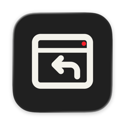
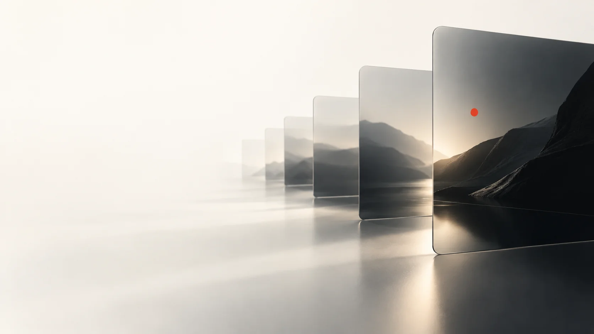
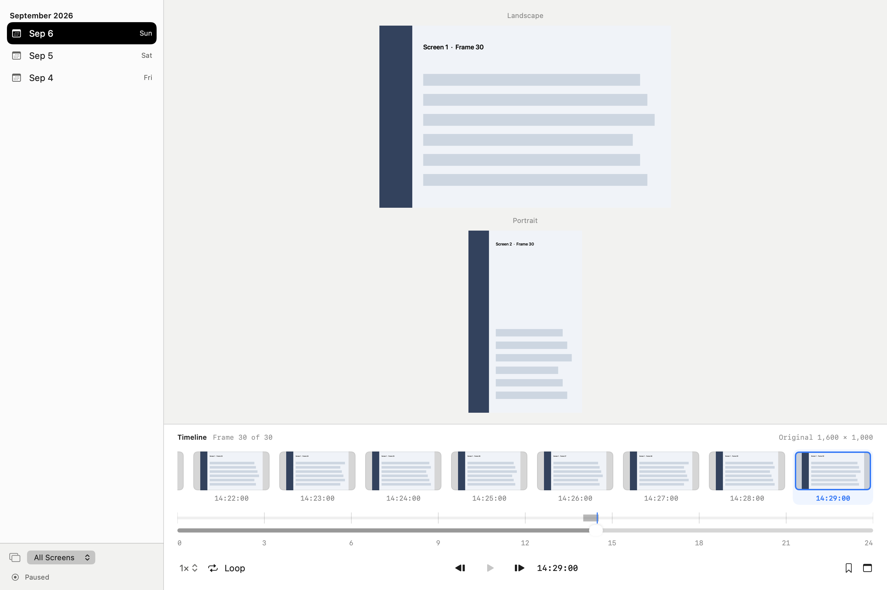

# ScreenRecall

[English](README.md) · [简体中文](README.zh-Hans.md) · [日本語](README.ja.md) · [한국어](README.ko.md) · [Español](README.es.md)

## macOS 로컬 화면 기록

화면의 순간을 Mac에 보관합니다. 날짜, 시간, 디스플레이별로 돌아보고 중요한 화면에 즐겨찾기와 메모를 추가하세요.



## 주요 기능

여러 디스플레이의 시각적 타임라인을 탐색하고 즐겨찾기, 메모, 메타데이터 검색으로 다시 찾습니다. 지정 간격 기록, 한 번 캡처, 짧은 집중 기록을 지원합니다.



[어두운 화면](Documentation/product-dark.png)

## 개인정보와 저장

이미지, SQLite 카탈로그, 설정은 Mac에 저장됩니다. 계정이나 클라우드는 필요하지 않습니다. 기록하려면 macOS 화면 기록 권한이 필요합니다. 화면에 보이는 내용이 저장될 수 있으며 시작할 때 저장된 기록 상태가 재개될 수 있습니다.

## 제한

검색은 카탈로그 메타데이터를 사용하며 이미지의 글자를 읽는 OCR은 없습니다. 공증된 공개 바이너리 배포판은 아직 없습니다. UI는 8개 언어이며 이 문서는 웹사이트와 같은 5개 언어입니다.

## 빌드와 사용

macOS 27 이상, Swift 6.2 이상과 Icon Composer 도구가 있는 Xcode, pkg-config, libwebp 1.6.0이 필요합니다. 고정된 DeparturePixelZh Compact 글꼴과 고지문이 포함되어 있습니다. 개발 도구는 따로 설치하세요.

순서대로 서명·설치·실행 없는 빌드, 서명된 앱 준비, 일상 앱을 유지한 합성 데이터 데모 실행입니다.

```sh
./script/build_and_run.sh --unsigned-only
./script/build_and_run.sh --build-only
./script/build_and_run.sh --demo
```

## 데이터 위치

일반 설정과 캡처 라이브러리는 홈의 Library/Application Support/ScreenRecall을 사용합니다. 빌드, 데모, 이전 앱은 소스 밖의 Library/Caches/ScreenRecall에 저장됩니다. 기존 설치는 선택한 데이터 경로를 유지할 수 있습니다.

설정: 빌드 경로 `SCREENRECALL_BUILD_ROOT`, 설치 후 캡처 및 실행 데이터 경로 `SCREENRECALL_DATA_DIRECTORY`(미설정 시 기존 앱 값 유지), 서명 ID `SCREENRECALL_SIGN_IDENTITY`(저장된 ID, 사용 가능한 Apple ID, 임시 서명 순), 고정 글꼴 입력 `DEPARTURE_PIXEL_ZH_BUILD_ROOT`(변경된 바이트는 거부).

일반 설정은 현재 macOS 사용자의 `Library/Application Support/ScreenRecall`에 남으며 셸의 `HOME`을 바꿔도 분리되지 않습니다. 합성 데이터 격리 테스트에는 `--demo`를 사용하세요.

`./script/build_and_run.sh --verify`는 앱을 설치하고 실행합니다. 저장된 기록 상태가 재개될 수 있습니다.

## 라이선스

자체 코드: [GPL-3.0-only](LICENSE), [적용 범위](LICENSE_SCOPE.md). 원본 아이콘 레이어는 CC BY 4.0: [아트워크](ARTWORK.md). 의존성과 글꼴은 기존 조건을 유지합니다: [제3자 고지](THIRD_PARTY_NOTICES.md).

ScreenRecall · codingEzio · 0.5.9 (24).
