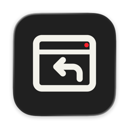
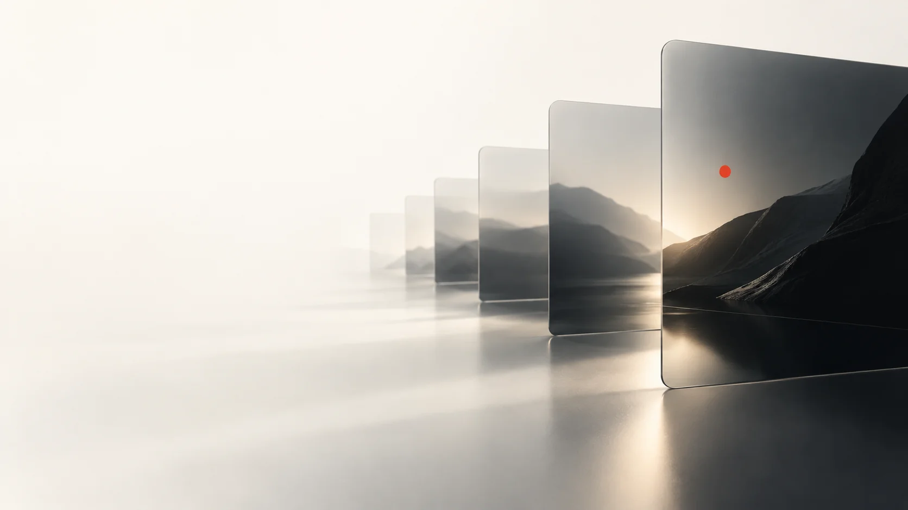
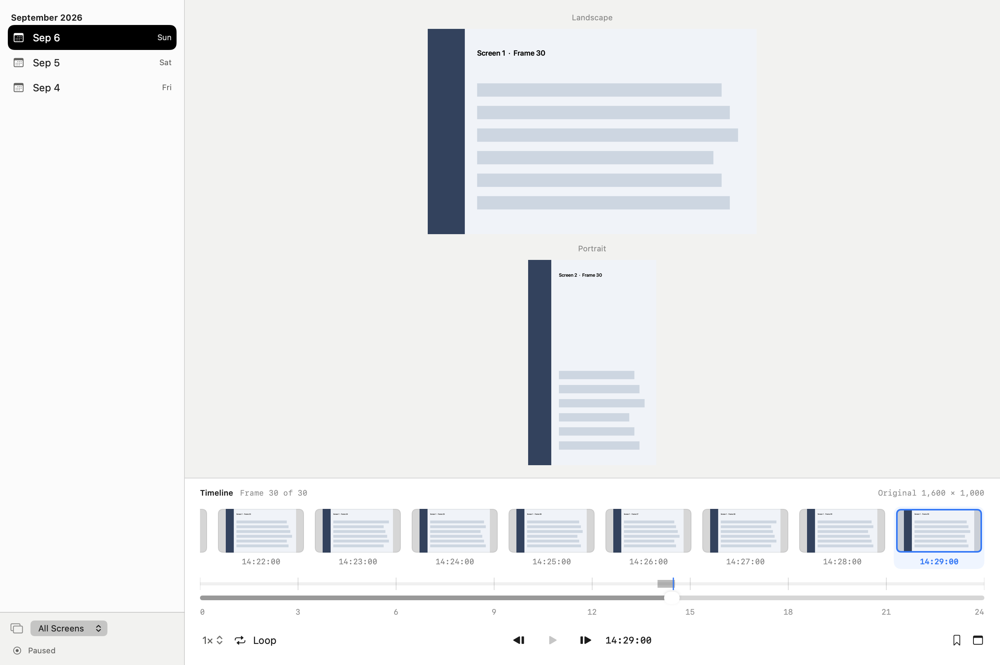

# ScreenRecall

[English](README.md) · [简体中文](README.zh-Hans.md) · [日本語](README.ja.md) · [한국어](README.ko.md) · [Español](README.es.md)

## Local screen history for macOS

Keep screen moments on your Mac. Browse by date, time and display, then mark favorites or add notes when a frame matters.



## What you can do

Browse a visual timeline across multiple displays. Use favorites, notes and metadata search to find a moment again. Record at a chosen interval, take a single capture, or use a short burst.



[Dark appearance](Documentation/product-dark.png)

## Privacy and storage

Images, the SQLite catalog and preferences stay on the Mac. No account or cloud service is required. Screen recording requires macOS permission. Captures can contain anything visible on your displays: choose recording intent carefully. The app can resume saved recording intent when it starts.

## Limits

Search uses catalog metadata; it does not read text inside screenshots (OCR). This source has no notarized public binary release. The interface has eight languages; documentation here follows the five website languages.

## Build and try

Requires macOS 27+, Xcode with Swift 6.2+ and Icon Composer tools, pkg-config and libwebp 1.6.0. The pinned DeparturePixelZh Compact font and its notices are included. Install prerequisites separately.

```sh
# Build only; no signing, installation, launch or recording
./script/build_and_run.sh --unsigned-only
# Sign a staged app; no installation or launch
./script/build_and_run.sh --build-only
# Launch a separate app with synthetic images; preserve the daily app
./script/build_and_run.sh --demo
```

## Data locations

Normal preferences and the capture library use Library/Application Support/ScreenRecall under your home folder. Builds, demos and rollback apps use Library/Caches/ScreenRecall outside the source tree. An existing installation can retain its chosen data directory.

`SCREENRECALL_BUILD_ROOT`: override the build/cache root.
`SCREENRECALL_DATA_DIRECTORY`: choose the installed app’s capture and runtime data root; an existing bundle value is retained when unset. Normal preferences remain under the current macOS user’s `Library/Application Support/ScreenRecall`, even if the shell `HOME` changes. Use `--demo` for isolated synthetic testing.
`SCREENRECALL_SIGN_IDENTITY`: choose a signing identity; otherwise use the saved identity, an available Apple identity, or ad-hoc signing.
`DEPARTURE_PIXEL_ZH_BUILD_ROOT`: override the included pinned font input; altered font bytes are rejected.

`./script/build_and_run.sh --verify` installs and launches the app. It can resume saved recording intent.

## License

GPL-3.0-only: [LICENSE](LICENSE), [scope](LICENSE_SCOPE.md). Original icon layers: CC BY 4.0, [artwork](ARTWORK.md). Dependencies and fonts retain their original terms: [third-party notices](THIRD_PARTY_NOTICES.md).

ScreenRecall · codingEzio · 0.5.9 (24).
