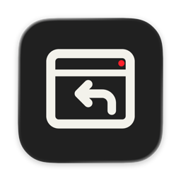
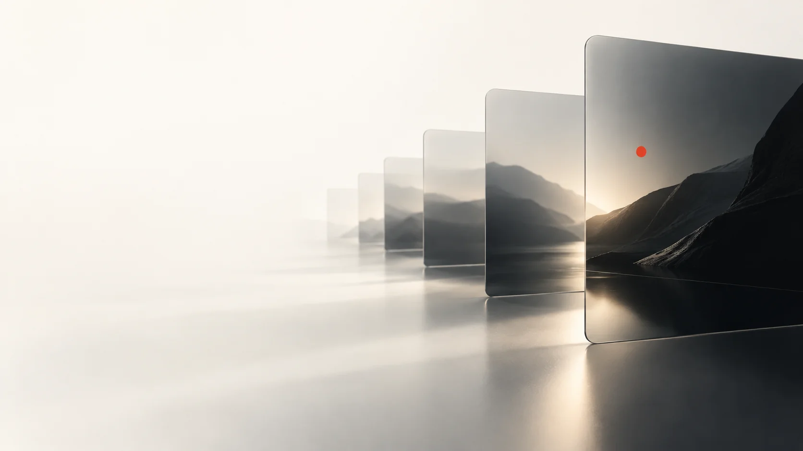
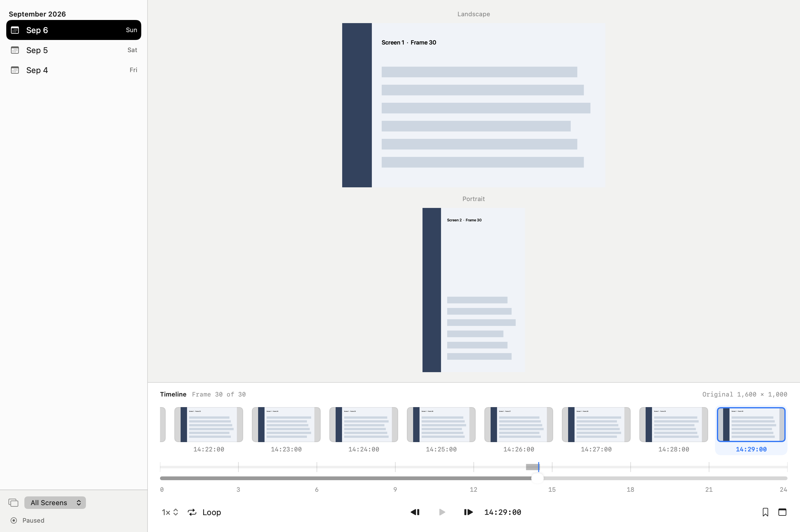

# ScreenRecall

[English](README.md) · [简体中文](README.zh-Hans.md) · [日本語](README.ja.md) · [한국어](README.ko.md) · [Español](README.es.md)

## macOS 本地屏幕历史

把屏幕片段留在 Mac 上，按日期、时间和显示器回看；为重要画面添加收藏和备注。



## 可以做什么

浏览多显示器的视觉时间线，用收藏、备注和元数据搜索找回某个时刻。按指定间隔录制、单次截图，或进行短时密集录制。



[深色外观](Documentation/product-dark.png)

## 隐私与存储

图片、SQLite 目录和偏好设置保存在本机，不需要账号或云端服务。录制需要 macOS 屏幕录制权限。截图可能包含屏幕上可见的任何内容，请谨慎选择录制状态；应用启动时可恢复已保存的录制意图。

## 限制

搜索使用目录元数据，不识别截图里的文字（OCR）。目前没有经过公证的公开二进制发行版。界面提供八种语言；介绍文件对应网站的五种语言。

## 构建与试用

需要 macOS 27+、带 Swift 6.2+ 与 Icon Composer 工具的 Xcode、pkg-config 和 libwebp 1.6.0。仓库已包含固定版本的 DeparturePixelZh Compact 字体及其声明。前置工具需另行安装。

依次为：仅构建且不签名、不安装、不启动；构建并签名暂存应用；启动合成数据演示且保留日用应用。

```sh
./script/build_and_run.sh --unsigned-only
./script/build_and_run.sh --build-only
./script/build_and_run.sh --demo
```

## 数据位置

常规设置和截图库位于用户目录下的 Library/Application Support/ScreenRecall。构建、演示和回退应用位于源码之外的 Library/Caches/ScreenRecall。现有安装可继续使用原先选定的数据目录。

可用设置：构建缓存根目录 `SCREENRECALL_BUILD_ROOT`；安装后的截图与运行数据根目录 `SCREENRECALL_DATA_DIRECTORY`（未设定时沿用既有应用的值）；签名身份 `SCREENRECALL_SIGN_IDENTITY`（未设定时依次使用已保存身份、可用 Apple 身份、临时签名）；固定字体输入 `DEPARTURE_PIXEL_ZH_BUILD_ROOT`（字体字节变化会被拒绝）。

常规设置仍在当前 macOS 用户的 `Library/Application Support/ScreenRecall`，修改 shell 的 `HOME` 不会隔离设置。使用 `--demo` 进行隔离的合成数据测试。

`./script/build_and_run.sh --verify` 会安装并启动应用，可能恢复已保存的录制状态。

## 许可

自有代码：[GPL-3.0-only](LICENSE)，[适用范围](LICENSE_SCOPE.md)。原创图标图层采用 CC BY 4.0，见[图稿说明](ARTWORK.md)。依赖和字体保留原条款：[第三方声明](THIRD_PARTY_NOTICES.md)。

ScreenRecall · codingEzio · 0.5.9 (24).
